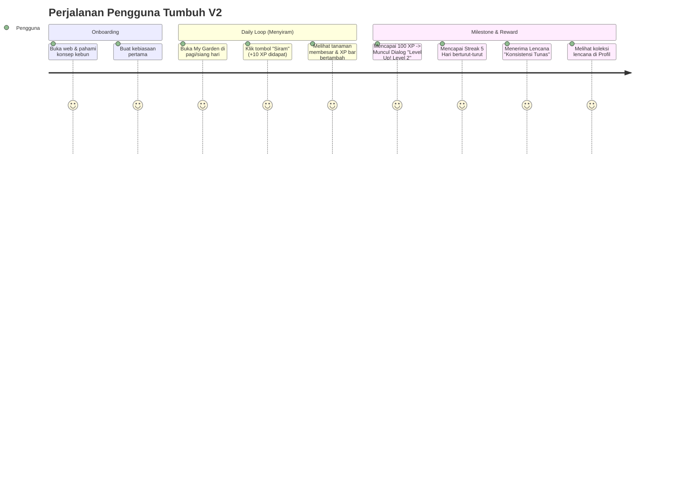
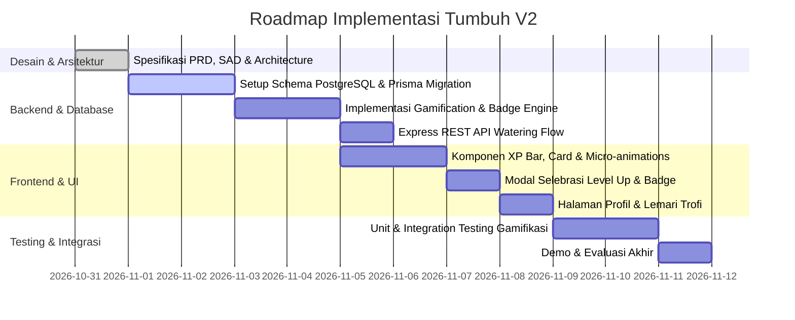

# Product Requirements Document (PRD) — Tumbuh V2
## *Gamified Habit Tracker with Plant Growth Metaphor*

---

### Informasi Dokumen
- **Nama Produk:** Tumbuh
- **Versi:** 2.0 (Pengembangan dari Prototype V1)
- **Status:** Approved / Ready for Architecture & Implementation
- **Target Platform:** Responsive Web (Mobile-First Web App / PWA Ready)
- **Tagline:** *Start small. Water daily. Grow consistently.*
- **Bahasa Antarmuka:** Bahasa Indonesia

---

## 1. Ringkasan Eksekutif & Visi Produk

**Tumbuh V2** adalah evolusi dari prototype habit tracker Tumbuh V1. Pada V1, fokus utama adalah memvalidasi metafora visual tanaman (bibit hingga mekar) untuk meningkatkan kepuasan saat mencatat kebiasaan. 

Pada **V2**, Tumbuh mengintegrasikan **Sistem Gamifikasi Inti (Core Gamification Engine)** yang mencakup:
1. **Experience Points (XP):** Reward instan setiap kali pengguna melakukan aktivitas positif (menyiram tanaman/check-in kebiasaan).
2. **Sistem Level Pengguna (User Level & Tiers):** Akumulasi progres jangka panjang yang merefleksikan dedikasi pengguna sebagai seorang "Pekebun Kebiasaan".
3. **Sistem Lencana Prestasi (Badges / Achievements):** Pengakuan dan penghargaan atas pencapaian milestone konsistensi, seperti mencapai streak 5 hari, panen perdana, dan keragaman kebiasaan.

Tujuan utama V2 adalah meningkatkan **Day-7 dan Day-30 User Retention** serta frekuensi keterlibatan harian (*daily engagement*) melalui *instant gratification loop* yang positif, suportif, dan bebas stres (*anxiety-free*).

---

## 2. Evaluasi dari V1 ke V2

| Aspek | Tumbuh V1 | Tumbuh V2 |
| :--- | :--- | :--- |
| **Fokus Utama** | Validasi fungsional dasar & metafora visual tanaman | Retensi pengguna & penguatan kebiasaan jangka panjang |
| **Konsep Aksi & Metafora** | Check-in harian (menandai selesai secara umum) | Check-in harian dengan metafora visual **"Menyiram Tanaman"** |
| **Umpan Balik Selesai** | Tanaman bertumbuh per tahapan hari (0, 3, 7, 30 hari) | Tanaman bertumbuh + Reward XP instan (+10 XP) + Progres Level |
| **Apresiasi Konsistensi** | Angka streak teks biasa | Lencana visual berjenjang (misal: Lencana Streak 5 Hari) + Bonus XP |
| **Progres Global Pengguna** | Hanya per tanaman individu | Progres gabungan seluruh kebiasaan melalui Level Profil Pekebun |
| **Ruang Apresiasi** | Hanya kartu tanaman di beranda | Lemari Trofi / Koleksi Lencana di Halaman Profil |
| **Arsitektur Teknis** | Prototipe monolitik sederhana | Terpisah (*Decoupled*): Frontend React 18 SPA berbasis Vite (`Code/frontend`, port 5173), Backend Node.js Express REST API (`Code/backend`, port 8000) dengan Prisma ORM & PostgreSQL 17 (Port 5433), dikelola secara persisten via Systemd Daemon |
| **Beban Rendering Animasi** | Client/browser | **100% Client-Side GPU (0% Beban GPU Server)** via SVG & Hardware-Accelerated CSS |

---

## 3. Persona Pengguna & User Journey

### 3.1 Persona Pengguna
- **Demografi:** Usia 16–30 tahun (Pelajar, Mahasiswa, Pekerja Awal).
- **Karakteristik:** Akrab dengan aplikasi mobile, menyukai visual yang estetik (*clean/cozy*), mudah terdemotivasi oleh habit tracker tradisional yang kaku atau menghukum ketika gagal.
- **Tujuan:** Membangun rutinitas positif (misal: minum air, membaca buku 15 menit, jalan santai, tidur tepat waktu) secara konsisten dan menyenangkan.

### 3.2 User Journey V2

---

## 4. Ruang Lingkup Fitur V2 (Scope of Work)

### A. Fitur Inti yang Dipertahankan & Ditingkatkan dari V1
1. **Onboarding Cepat:**
   - Edukasi konsep kebun kebiasaan, langsung diarahkan membuat habit perdana tanpa registrasi berbelit.
2. **My Garden (Beranda Utama):**
   - Menampilkan ringkasan status pengguna di bagian atas (*Header Gamifikasi*): Avatar, Level saat ini, Title Pekebun, dan Mini XP Progress Bar.
   - Grid/Daftar kartu kebiasaan interaktif. Tiap kartu memiliki visual tanaman SVG responsif, nama habit, status hari ini, total penyiraman, dan badge streak saat ini.
   - Tombol aksi utama: **"Siram" (Watering Action)** sebagai metafora check-in harian.
3. **Manajemen Kebiasaan Lengkap (Full CRUD Habit & Reminder):**
   - **Tanam Kebiasaan:** Tambah habit baru dengan nama, kategori, dan opsional waktu pengingat harian (`reminderTime`).
   - **Kelola & Edit Kebiasaan:** Ubah nama kebiasaan, kategori, serta jadwal jam pengingat harian kapan saja via dialog modal `EditHabitModal`.
   - **Hapus / Arsipkan Kebiasaan:** Hapus atau arsipkan tanaman secara aman dilengkapi proteksi dialog konfirmasi untuk mencegah ketidaksengajaan.
   - **Preferensi Pengingat:** Waktu pengingat disimpan per habit dan terintegrasi dengan browser Web Notification API.
4. **Sistem Pertumbuhan Tanaman (Visual Metafora & Pohon Rindang Berkelanjutan):**
   - *Seed (Benih):* 0–2 hari penyiraman
   - *Sprout (Tunas):* 3–6 hari penyiraman
   - *Growing (Tumbuh Rindang):* 7–29 hari penyiraman (berdaun lebat berlapis dengan kuncup bunga di pucuk)
   - *Bloom (Mekar Sempurna & Berbunga Progresif):* ≥ 30 hari penyiraman. Tanaman tidak berhenti tumbuh setelah mekar perdana, melainkan semakin rimbun dan memekarkan bunga bertingkat hingga maksimal 5 bunga:
     - **30x Siram (Mekar Perdana):** Mahkota pohon mekar dengan 1 bunga utama di puncak (`🌸 1/5 Bunga`).
     - **31x Siram:** Tumbuh cabang kiri baru lengkap dengan dedaunan hijau segar.
     - **32–33x Siram (Mekar Bercabang):** Mekar 2 bunga (`🌸 2/5 Bunga`), bunga kedua merekah di dahan kiri bawah.
     - **34–35x Siram (Rindang Berbunga):** Tumbuh cabang kanan baru dan mekar 3 bunga (`🌸 3/5 Bunga`) di dahan kanan.
     - **36–37x Siram (Harmoni Mahkota):** Tumbuh dahan atas kiri dan mekar 4 bunga (`🌸 4/5 Bunga`).
     - **≥ 38x Siram (Mahkota Megah):** Dahan atas kanan tumbuh sempurna dan memekarkan maksimal 5 bunga (`🌸 5/5 Bunga`) disertai aura kilau keemasan (*golden sparkles*) memancarkan dedikasi paripurna.
   - **Prinsip Non-Punitive:** Melewatkan hari tidak pernah membunuh tanaman atau menurunkan tahap pertumbuhan historis.
5. **Riwayat Mingguan (Weekly History 7 Hari):**
   - Setiap kartu tanaman menampilkan strip 7 titik indikator hari kalender lokal pengguna (Senin s.d. Minggu).
   - Menandai hari disiram dengan centang hijau (`✓`), hari belum disiram dengan titik lembut (`·`), dan memberikan aksen cincin pada hari ini.
6. **Detail Kebiasaan & Pemulihan Suportif (Supportive Recovery):**
   - Pengguna dapat mengetuk kartu atau tombol *"Detail"* untuk membuka `HabitDetailModal`.
   - Menyajikan ringkasan statistik (Streak saat ini, Total penyiraman kumulatif, Rekor streak tertinggi), deskripsi tahap morfologi tanaman, dan riwayat 7 hari lengkap.
   - **Kartu Pemulihan (Supportive Recovery):** Memberikan pesan penyemangat ramah non-hukuman jika pengguna melewatkan hari: *"Di Tumbuh, tanamanmu tidak pernah layu atau mati meskipun terlewat beberapa hari. Konsistensi dibangun selangkah demi selangkah. Setiap tetesan air hari ini menyambung kembali pertumbuhan kebunmu! 🌿"*. Pengguna dapat langsung menekan tombol *"Siram untuk Memulihkan"* tanpa hambatan.
7. **Sub-Menu Kebun Aktif & Arsip Kebun (Garden Sub-Navigation & Restore):**
   - Toggle sub-menu interaktif: **"🌱 Kebun Aktif"** dan **"📦 Arsip Kebun"** dengan counter badge jumlah kebiasaan dinamis.
   - Tanaman yang diarsipkan tidak hilang dari database (*soft-delete* dengan `isActive = false`), melainkan tersimpan rapi di tab *Arsip Kebun*.
   - Pada kartu arsip, pengguna dapat melihat statistik historis (Streak rekor & total disiram), memulihkan kembali (*restore*) ke kebun aktif seketika via tombol *"Pulihkan"*, atau menghapus permanen dengan dialog konfirmasi.
8. **Sistem Pagination Otomatis Kebun (Garden Pagination & New Habit Auto-Landing):**
   - Membatasi tampilan kartu kebun maksimal **6 tanaman per halaman** (*page size = 6*) baik pada *Kebun Aktif* maupun *Arsip Kebun*, menjaga performa render dan kerapian antarmuka saat pengguna memiliki puluhan kebiasaan.
   - Navigasi halaman yang intuitif: Tombol Sebelumnya (`◀`), Tombol Berikutnya (`▶`), tombol nomor halaman interaktif dengan kompresi elipsis (`…`), serta indikator informatif (*"Menampilkan X–Y dari Z tanaman"*).
   - **Pengurutan Newest-First & Auto-Landing Halaman 1:** Kebun Aktif secara konsisten diurutkan dari yang terbaru ditanam (`createdAt DESC`). Setiap kali pengguna menanam habit baru via modal *"Tanam Habit"*, tanaman baru tersebut otomatis mendarat di posisi pertama Halaman 1 Kebun Aktif, dan kebiasaan lain tergeser (*shifted*) ke urutan berikutnya. Layar otomatis melakukan *smooth scroll* ke banner kebun.
   - Komponen navigasi pagination otomatis disembunyikan (*auto-hidden*) jika total tanaman berjumlah $\le 6$.

---

### B. Fitur Baru V2: Sistem Gamifikasi (Level, XP, Badges)

#### 1. Mekanika Experience Points (XP)
XP adalah representasi angka atas usaha positif yang dikeluarkan pengguna. Aturan perolehan XP:

| Aksi / Pemicu | Nilai XP | Ketentuan & Batasan |
| :--- | :--- | :--- |
| **Menyiram Tanaman (Check-in Harian)** | **+10 XP** | Maksimal 1x per habit per hari kalender lokal pengguna. |
| **Bonus Streak Milestone 3 Hari** | **+25 XP** | Diberikan 1x saat kebiasaan pertama kali menyentuh streak 3 hari berturut-turut. |
| **Bonus Streak Milestone 5 Hari** | **+50 XP** | Diberikan saat mencapai streak 5 hari berturut-turut. |
| **Bonus Streak Milestone 14 Hari** | **+100 XP** | Diberikan saat mencapai streak 14 hari berturut-turut. |
| **Bonus Tanaman Mekar (Bloom Stage)** | **+150 XP** | Diberikan saat tanaman mencapai 30 total hari penyiraman. |
| **Bonus Hari Sempurna (All Habits Done)** | **+20 XP** | Diberikan jika pengguna menyiram seluruh habit aktifnya dalam satu hari (min. 2 habit). |

**Ketentuan Teknis XP:**
- Perhitungan XP sepenuhnya **server-authoritative** (dihitung dan divalidasi di backend untuk menjaga integritas).
- Setiap transaksi XP dicatat di tabel audit log lengkap dengan `source_type` dan `idempotency_key` untuk mencegah eksploitasi klik ganda.

---

#### 2. Mekanika Level & Tingkatan Pekebun (Level System)
Level mencerminkan total XP kumulatif yang telah dicapai pengguna. Setiap kali batas XP level terpenuhi, level pengguna naik secara instan dan memicu dialog selebrasi.

**Tabel Konfigurasi Level:**

| Level | Gelar (Title) | Ambang Batas XP Kumulatif | XP Dibutuhkan dari Level Sebelumnya |
| :---: | :--- | :---: | :---: |
| **1** | Penyemai Benih (*Seed Sower*) | 0 XP | 0 XP (Level Awal) |
| **2** | Penyiram Rajin (*Diligent Waterer*) | 100 XP | 100 XP (Contoh: 10x siram) |
| **3** | Penjaga Tunas (*Sprout Tender*) | 250 XP | 150 XP |
| **4** | Pekebun Muda (*Junior Gardener*) | 450 XP | 200 XP |
| **5** | Sahabat Daun (*Foliage Keeper*) | 700 XP | 250 XP |
| **6** | Pengurus Kebun (*Garden Steward*) | 1.000 XP | 300 XP |
| **7** | Botanis Berbakat (*Gifted Botanist*) | 1.400 XP | 400 XP |
| **8** | Penjaga Rindang (*Canopy Guardian*) | 1.900 XP | 500 XP |
| **9** | Ahli Ekosistem (*Ecosystem Master*) | 2.500 XP | 600 XP |
| **10** | Dewa Flora (*Floral Legend*) | 3.200 XP | 700 XP |

**Formula Dinamis Level (Setelah Level 10):**
$$\text{XP Diperlukan untuk Level } n = \text{XP Level } (n-1) + (n \times 80)$$

**Tampilan Puncak Max Level (Opsi A — Prestigious Max Level Label):**
- Ketika pengguna mencapai Level 10 (*Dewa Flora*) dan total perolehan XP telah melampaui ambang batas akhir level 10 (3.200 XP), header gamifikasi tidak lagi menampilkan format perbandingan ganjil yang melebihi batas penyebutnya (seperti `6325 / 4080 XP`), melainkan berlabel elegan:
  $$\text{XP Progres: } \mathbf{X.XXX\text{ XP (MAX LEVEL)}}$$
  *(Contoh: `6.325 XP (MAX LEVEL)`)*
- Bar progres XP terkunci penuh pada persentase **100%** dengan bendera `isMaxLevel: true`, memberikan pengakuan visual prestisius atas pencapaian puncak pengguna tanpa menimbulkan kebingungan batas angka.

---

#### 3. Sistem Lencana Prestasi (Badges & Achievement System)
Lencana adalah trofi visual yang diberikan kepada pengguna ketika kriteria spesifik terpenuhi.

**Katalog Lencana V2:**

| ID Lencana | Nama Lencana | Kategori | Syarat Pembukaan (Trigger) | Hadiah XP | Ikon / Metafora |
| :--- | :--- | :--- | :--- | :---: | :--- |
| `first_water` | **Tetesan Pertama** | Milestone | Menyiram tanaman pertama kali | +20 XP | Tetes air berkilau |
| `streak_3` | **Langkah Awal** | Streak | Mencapai streak 3 hari pada habit apa pun | +25 XP | Dua tunas kembar |
| `streak_5` | **Konsistensi Tunas** | Streak | **Mencapai streak 5 hari berturut-turut** | **+50 XP** | Daun lima jari emas |
| `streak_14` | **Akar Kokoh** | Streak | Mencapai streak 14 hari berturut-turut | +100 XP | Pohon dengan akar kuat |
| `streak_30` | **Bunga Abadi** | Streak | Mencapai streak 30 hari berturut-turut | +200 XP | Teratai bermahkota kristal |
| `habit_trio` | **Kebun Asri** | Diversitas | Memiliki minimal 3 kebiasaan aktif berjalan | +30 XP | Tiga pot berjajar |
| `first_bloom` | **Panen Perdana** | Pertumbuhan | Membawa 1 tanaman mencapai tahap *Bloom* (30 hari) | +150 XP | Bunga mekar warna-warni |
| `early_bird` | **Embun Pagi** | Jam Disiplin | Menyiram kebiasaan sebelum pukul 07.30 pagi | +15 XP | Matahari terbit & daun |
| `night_owl` | **Penyiram Senja** | Jam Disiplin | Menyiram kebiasaan setelah pukul 20.00 malam | +15 XP | Bulan sabit & bintang |

---

### C. Alur & Interaksi UI/UX Gamifikasi

1. **Efek Umpan Balik Instan Saat Menyiram (Instant Feedback Loop):**
   - Saat pengguna menekan tombol "Siram":
     - Tombol berubah menjadi status selesai dengan centang hijau lembut.
     - Animasi tanaman bergoyang lembut atau memancarkan partikel tetes air (CSS/SVG micro-animation).
     - Teks animasi mengambang (*floating pill*): `+10 XP` meluncur naik secara halus.
     - XP Progress Bar di bagian atas bertambah dengan transisi *spring animation* yang mulus.
2. **Modal Selebrasi Naik Level (Level-Up Celebration Modal):**
   - Muncul otomatis segera setelah XP akumulatif menembus ambang level baru.
   - Elemen: Efek konfeti partikel ringan (menggunakan lightweight SVG/Canvas), suara/getar haptik (opsional jika didukung browser), tampilan nomor level baru dan title baru, serta pesan motivasi personal.
3. **Modal Selebrasi Lencana Baru (Badge Unlocked Modal):**
   - Muncul jika aksi menyiram memenuhi syarat lencana (misal: streak hari ke-5).
   - Menampilkan animasi lencana berputar/memancar lembut (*gleam effect*), judul lencana, deskripsi capaian, dan tambahan bonus XP yang didapat.
4. **Halaman / Tab Profil & Lemari Trofi (Trophy Room):**
   - Menampilkan total XP, Level saat ini, Title, serta galeri seluruh lencana.
   - Lencana yang belum terbuka ditampilkan dalam status siluet abu-abu redup (*locked state*) dengan teks petunjuk cara mendapatkannya, memicu rasa ingin tahu (*curiosity loop*).
   - Lencana yang sudah terbuka tampil penuh warna dengan tanggal pencapaian.

---

## 5. Fitur di Luar Scope (Out of Scope untuk V2)
Untuk menjaga fokus pada stabilitas, kecepatan rilis, dan kemudahan pengujian, fitur berikut **TIDAK** disertakan di V2:
- Sistem pertemanan, leaderboard publik, dan interaksi sosial (*Shared Garden* / PvP).
- Pasar virtual, koin belanja, pembelian tema tanaman dengan uang sungguhan (*Monetization / Microtransactions*).
- Grafis 3D kompleks (Three.js / WebGL berat).
- Fitur AI Habit Coach atau NLP reflection journaling.
- Sistem hukuman (*Streak freeze* berbayar atau pengurangan XP saat bolong).

---

## 6. Kebutuhan Non-Fungsional (Non-Functional Requirements / NFR)

| Parameter | Kebutuhan Spesifik |
| :--- | :--- |
| **Performa & Latensi** | Waktu respons API untuk aksi menyiram tanaman dan evaluasi gamifikasi harus selesai dalam **< 300 ms**. |
| **Idempotensi & Konsistensi** | Aksi menyiram berkali-kali pada hari yang sama tidak boleh menduplikasi XP atau memicu lencana ganda. Database level constraint wajib diterapkan. |
| **Responsivitas & Tampilan** | Mobile-First design: Tampilan optimal pada viewport layar 360px hingga layar desktop 4K. |
| **Aksesibilitas (A11y)** | Rasio kontras warna teks dan elemen UI memenuhi standar WCAG 2.1 AA. Mendukung preferensi sistem `prefers-reduced-motion` untuk mematikan konfeti/animasi cepat. |
| **Ketahanan Data (Reliability)** | Penyimpanan data persisten yang andal. Kegagalan koneksi sesaat harus menampilkan pesan informatif ramah tanpa kehilangan state lokal. |

---

## 7. Aturan Bisnis & Logika Domain

1. **Penentuan "Hari Ini" (Timezone Consistency):**
   - Tanggal kalender dihitung berdasarkan waktu lokal pengguna (`user_timezone`, misal `Asia/Jakarta`).
   - Batas pergantian hari adalah pukul 00:00:00 waktu lokal, bukan UTC.
2. **Kalkulasi Streak:**
   - Streak bertambah +1 jika pengguna menyiram pada hari berikutnya setelah hari penyiraman terakhir ($D = D_{last} + 1$).
   - Jika pengguna melewatkan 1 hari kalender ($D > D_{last} + 1$), streak saat ini direset ke 1 (hari aktif saat ini).
   - Total hari selesai kumulatif (*lifetime completions*) **tidak pernah berkurang**.
3. **Integritas Penambahan XP:**
   - XP hanya dapat diperoleh dari sumber yang terverifikasi di backend.
   - XP untuk check-in harian diikat pada pasangan `(habit_id, check_in_date)`.
4. **Evaluasi Lencana Otomatis:**
   - Setelah transaksi check-in dan kalkulasi XP berhasil, sistem memicu *Badge Rule Evaluator*.
   - Jika kriteria lencana terpenuhi dan pengguna belum memilikinya, lencana langsung diberikan, XP bonus ditambahkan, dan payload respons mengembalikan bendera `new_badge_unlocked: true`.

---

## 8. User Stories & Kriteria Penerimaan (Acceptance Criteria)

### Story 1: Menyiram Kebiasaan & Menerima XP
> **Sebagai** pengguna Tumbuh,  
> **Saya ingin** menyiram kebiasaan harian saya dan langsung menerima 10 XP,  
> **Agar** saya merasakan kepuasan instan dan termotivasi menjaga kebiasaan.

- **Scenario 1.1: Menyiram pertama kali di hari ini**
  - **Given** pengguna memiliki kebiasaan "Minum Air 2L" yang belum disiram hari ini.
  - **When** pengguna menekan tombol "Siram".
  - **Then** status tombol berubah menjadi "Sudah Disiram".
  - **And** sistem menambahkan 10 XP ke profil pengguna.
  - **And** muncul animasi mengambang "+10 XP".
  - **And** XP bar di header bertambah secara proporsional.

- **Scenario 1.2: Pencegahan klik berulang (Idempotency)**
  - **Given** kebiasaan "Minum Air 2L" sudah disiram hari ini.
  - **When** tombol ditekan kembali atau terjadi request duplikat dari network.
  - **Then** sistem menolak penambahan XP dan tidak membuat record duplikat.
  - **And** tampilan UI tetap menunjukkan status sudah disiram.

---

### Story 2: Naik Level Pengguna
> **Sebagai** pengguna Tumbuh yang aktif,  
> **Saya ingin** naik level secara otomatis ketika XP saya mencapai batas tertentu (misal: 100 XP),  
> **Agar** saya melihat bukti nyata dari pertumbuhan komitmen saya.

- **Scenario 2.1: Menembus ambang batas level**
  - **Given** pengguna berada di Level 1 dengan 90 XP.
  - **When** pengguna menyiram kebiasaan dan mendapatkan +10 XP (total 100 XP).
  - **Then** level pengguna berubah menjadi Level 2 ("Penyiram Rajin").
  - **And** muncul dialog selebrasi "Level Up!" dengan animasi konfeti.
  - **And** XP bar menyesuaikan target level berikutnya (250 XP).

---

### Story 3: Membuka Lencana Streak 5 Hari
> **Sebagai** pengguna yang konsisten,  
> **Saya ingin** mendapatkan lencana "Konsistensi Tunas" saat mencapai streak 5 hari,  
> **Agar** pencapaian konsistensi saya diakui dan tercatat di profil.

- **Scenario 3.1: Streak mencapai 5 hari**
  - **Given** kebiasaan pengguna telah disiram 4 hari berturut-turut (streak = 4).
  - **When** pengguna menyiram kebiasaan tersebut pada hari ke-5.
  - **Then** streak kebiasaan bertambah menjadi 5.
  - **And** sistem membuka lencana `streak_5` ("Konsistensi Tunas").
  - **And** sistem memberikan bonus +50 XP.
  - **And** muncul modal selebrasi lencana baru yang dapat ditutup pengguna.
  - **And** lencana tersebut muncul sebagai item terbuka di Halaman Profil.

---

### Story 4: Autentikasi Sederhana (Login & Sign Up)
> **Sebagai** pengguna atau calon pengguna Tumbuh,  
> **Saya ingin** mendaftarkan akun baru atau masuk dengan form yang sederhana (hanya kolom User dan Password),  
> **Agar** proses akses ke kebun saya berlangsung cepat, tanpa kerumitan verifikasi email atau session cookie yang membingungkan.

- **Scenario 4.1: Pendaftaran akun baru (Sign Up)**
  - **Given** calon pengguna berada di Halaman Login pada tab "Daftar (Sign Up)".
  - **When** pengguna memasukkan Username dan Password lalu menekan tombol "Daftar & Mulai Menanam".
  - **Then** sistem memvalidasi bahwa username belum pernah terdaftar sebelumnya.
  - **And** sistem membuat user baru di PostgreSQL lengkap dengan profil gamifikasi awal (Level 1, 0 XP, Gelar 'Penyemai Benih') dan 3 tanaman awal (*starter plants*).
  - **And** pengguna langsung diarahkan masuk ke antarmuka "Kebun Saya".

- **Scenario 4.2: Masuk ke kebun (Login) & Validasi Database**
  - **Given** pengguna telah terdaftar di database.
  - **When** pengguna memasukkan Username dan Password pada tab "Masuk (Login)" dan menekan tombol "Masuk ke Kebun Saya".
  - **Then** sistem memvalidasi kecocokan username dan password secara langsung ke database.
  - **And** jika cocok, data user disimpan di `localStorage` klien dan langsung masuk ke "Kebun Saya" tanpa token JWT / session cookies.
  - **And** jika tidak cocok, sistem menampilkan pesan error yang ramah dan jelas.

---

### Story 5: Isolasi Data Multi-User & Keluar Akun (Logout)
> **Sebagai** pengguna Tumbuh,  
> **Saya ingin** seluruh data tanaman, XP, level, dan koleksi lencana saya terpisah seutuhnya dari pengguna lain,  
> **Serta dapat** keluar atau berganti akun kapan pun melalui tombol Logout yang jelas di halaman utama.

- **Scenario 5.1: Isolasi data tanaman, XP, dan lencana**
  - **Given** Pengguna A dan Pengguna B terdaftar dengan akun masing-masing.
  - **When** Pengguna A menyiram tanaman atau membuka lencana baru di akunnya.
  - **Then** seluruh perubahan XP, streak, dan lencana hanya tercatat untuk User ID Pengguna A.
  - **And** saat Pengguna B login, kebun, XP, dan lencana Pengguna B tetap independen tanpa kebocoran data.

- **Scenario 5.2: Keluar akun (Logout) dari halaman utama**
  - **Given** pengguna sedang aktif berada di halaman Kebun Saya.
  - **When** pengguna menekan tombol "Logout" di bar navigasi utama.
  - **Then** sistem menghapus status aktif pengguna di client (`localStorage`).
  - **And** antarmuka kembali ke Halaman Login & Sign Up dengan aman.

---

## 9. Desain Antarmuka Minimum (UI Specification)

### 9.1 Header Gamifikasi (Sticky Top)
- **Komponen Kiri:** Profil Avatar, Level Chip (misal: `Lvl 2`), Gelar (*Penyiram Rajin*).
- **Komponen Tengah/Kanan:** Bar Progres XP dengan label numerik (misal: `110 / 250 XP`) dan persentase visual.
- **Ikon Trofi:** Tautan cepat menuju Galeri Lencana di Profil.

### 9.2 Kartu Kebiasaan (Garden Card)
- **Visual Tanaman:** Ilustrasi 2D SVG bertahap (Benih, Tunas, Rindang, Bunga) responsif dengan micro-interaction saat disiram.
- **Meta Info:** Nama Kebiasaan, Kategori pill, Indikator Streak (misal: `🔥 5 Hari`), serta Badge Waktu Pengingat (misal: `⏰ 07:00`) jika disetel.
- **Riwayat Mingguan (Weekly Strip):** Strip 7 titik kalender lokal (Sen s.d. Min) yang menunjukkan status disiram (`✓`) atau terlewat (`·`), dengan cincin aksen pada hari ini.
- **Aksi Cepat:**
  - Tombol interaktif utama berukuran minimal 44x44px: *"Siram"* / *"Sudah Disiram Hari Ini"*.
  - Tombol *"Detail"* (🔍) untuk membuka ringkasan performa & kartu pemulihan suportif.
  - Tombol *"Edit"* (✏️) untuk mengubah preferensi kebiasaan atau jadwal pengingat.

### 9.3 Modal Selebrasi (Level Up & Badge Unlocked)
- Backdrop blur elegan (*glassmorphism*).
- Kartu modal di tengah layar dengan animasi *scale-in*.
- Ikon lencana/level berukuran besar beranimasi kilau (*gleam particle*).
- Tombol aksi: "Lanjutkan Menanam" atau "Bagikan Pencapaian" (opsional).

### 9.4 Modal Detail Kebiasaan & Pemulihan Suportif (Habit Detail & Recovery Modal)
- **Header:** Nama kebiasaan, kategori, dan tombol tutup cepat.
- **Visual Morfologi:** Ilustrasi tanaman SVG resolusi tinggi disertai label tahap morfologi (Bibit / Tunas / Rindang / Bunga Mekar) dan penjelasan pertumbuhan edukatif.
- **Ringkasan Statistik 3 Kolom:**
  - *Streak Saat Ini* (misal: 5 Hari berturut-turut)
  - *Rekor Streak Tertinggi* (misal: 14 Hari)
  - *Total Penyiraman* (misal: 30 Kali)
- **Kotak Pemulihan Suportif (Supportive Recovery Box):**
  - Desain berbingkai hijau herbal lembut dengan ikon tunas `🌱`.
  - Pesan empati non-hukuman: *"Di Tumbuh, tanamanmu tidak pernah layu atau mati meskipun terlewat beberapa hari. Konsistensi dibangun selangkah demi selangkah. Setiap tetesan air hari ini menyambung kembali pertumbuhan kebunmu! 🌿"*.
  - Tombol aksi cepat: *"Siram untuk Memulihkan (+10 XP)"* jika belum disiram hari ini.
- **Linimasa 7 Hari Terakhir:** Kalender mini 7 hari terakhir yang memperlihatkan riwayat lengkap hari disiram vs belum disiram.

### 9.5 Modal Kelola & Edit Kebiasaan (Edit Habit Modal)
- **Formulir Edit:**
  - Nama Kebiasaan (input teks berkarakter 1–120)
  - Kategori (pilihan preset: Kebugaran, Pembelajaran, Mindfulness, Produktivitas, Kesehatan)
  - Waktu Pengingat Harian (input format `HH:MM` opsional)
- **Tombol Simpan:** Memperbarui data kebiasaan secara realtime ke database PostgreSQL.
- **Zona Pengelolaan Aman (Safe Management Zone):**
  - Tombol *"Arsipkan / Hapus Kebiasaan"* bernada merah lembut.
  - Dilengkapi dialog konfirmasi ganda (*safety confirmation dialog*) untuk mencegah kehilangan data akibat klik yang tidak disengaja.

---

## 10. Rencana Pengujian (Test Matrix)

| Modul | Skenario Tes | Ekspektasi Hasil |
| :--- | :--- | :--- |
| **XP Logic** | Penambahan XP dari aksi siram harian | XP bertambah tepat +10; transaksi tercatat di database. |
| **XP Idempotency** | Pengiriman 5 request simultan untuk habit & tanggal sama | Hanya 1 transaksi yang berhasil; 4 lainnya diabaikan/idempotent. |
| **Level Engine** | Transisi XP: 99 XP -> 100 XP | Level berubah dari 1 ke 2; Title terupdate; event level up terpanggil. |
| **Streak Engine** | Menyiram di hari $H+1$, $H+2$, dan melompati $H+3$ | Streak naik di $H+1$ & $H+2$; streak ter-reset di $H+4$ tanpa menghapus riwayat. |
| **Badge Engine** | Streak mencapai hari ke-5 | Lencana `streak_5` terbuka; bonus +50 XP masuk; tidak duplikat di hari ke-6. |
| **UI Components** | Tampilan responsive di mobile 375px & desktop 1440px | Seluruh elemen kartu, XP bar, dan modal proporsional tanpa overflow horizontal. |
| **Re-engagement Copy** | Evaluasi 3 skenario: Habit belum disiram, 2+ hari terlewat, & user kembali | Banner menyajikan copywriting suportif bernada hangat, zero-guilt, dan aksi kontekstual. |
| **Notification API** | Pengguna mengklik tombol "Aktifkan Notifikasi Web" | Browser meminta izin via Notification API, menampilkan pesan konfirmasi ramah. |
| **Weekly History** | Tampilan strip 7 hari kalender lokal di setiap kartu tanaman | Menampilkan status disiram (centang hijau) dan terlewat secara akurat sesuai data database. |
| **Supportive Recovery** | Pengguna membuka modal detail habit setelah hari terlewat | Dialog menyajikan pesan pemulihan ramah tanpa hukuman & tombol langsung memulihkan kebun. |
| **Edit & Delete Habit** | Pengguna mengubah nama/kategori/jam pengingat atau menghapus habit | Form modal menyimpan update ke backend, dan aksi hapus terlindungi konfirmasi aman. |

---

## 11. Notifikasi & Re-engagement (Notification & Supportive Re-engagement)

Untuk menjaga motivasi pengguna tanpa menimbulkan kecemasan (*anxiety-free*), Tumbuh V2 mengadopsi prinsip notifikasi yang **hangat, suportif, dan ringkas**. Tumbuh **dilarang keras** menggunakan bahasa yang memicu rasa bersalah (*guilt*), mempermalukan (*shame*), atau urgensi yang agresif (*aggressive urgency*).

### 11.1 Matriks Situasi & Salinan Pesan (Copywriting Matrix)

| Situasi (Situation) | Kondisi Pemicu (Trigger Condition) | Contoh Salinan Pesan (Example Copy) | Aksi Pengguna (Action) |
| :--- | :--- | :--- | :--- |
| **Habit incomplete today** | Pengguna memiliki kebiasaan aktif yang belum disiram pada hari kalender saat ini ($T_{\text{today}}$). | 🔔 *Tanaman [Nama Habit]-mu menunggumu hari ini. Yuk siram sebentar!* *(EN: "Your [Habit] plant is waiting for you.")* | Buka & Siram Habit (*Open habit*) |
| **Several missed days** | Pengguna melewatkan $\ge 2$ hari kalender tanpa aktivitas penyiraman. Tanaman tidak mati, namun merindukan perhatian. | 🔔 *Tanamanmu merindukanmu. Yuk bantu ia tumbuh kembali bersama!* *(EN: "Your plant misses you. Let's help it grow again.")* | Kembali ke Kebun (*Return to Garden*) |
| **User returns** | Pengguna kembali membuka aplikasi dan menyiram tanaman setelah melewati jeda beberapa hari. | 🔔 *Selamat datang kembali! Senang melihatmu lagi, tanamanmu mulai tumbuh kembali.* *(EN: "Welcome back! Your plant is growing again.")* | Selesaikan Habit (*Complete habit*) |

### 11.2 Prinsip Nada Suara (Notification Tone Principles)
- **Warm & Supportive:** Menggunakan metafora tanaman hidup yang penuh kasih sayang.
- **Concise:** Pesan padat, jelas, dan langsung mengarahkan pada tindakan mudah.
- **Zero-Guilt Policy:** Tidak pernah menampilkan kalimat intimidatif seperti *"Kamu gagal mempertahankan streak!"* atau *"Tanamanmu akan mati jika tidak disiram!"*.
- **Multi-Channel Delivery:**
  1. *In-App Smart Banner:* Kartu sapaan kontekstual di bagian atas beranda kebun.
  2. *In-App Floating Alert Card (Pojok Kanan Bawah):* Kartu notifikasi melayang interaktif di sudut kanan bawah dengan tombol langsung "Siram Sekarang (+10 XP)", 100% tampil di Google Chrome, Safari (macOS & iOS), Edge, dan Firefox tanpa terhalang kebijakan gesture browser.
  3. *Web Browser Notification API & Service Worker:* Pengingat terjadwal di perangkat via Service Worker (`sw.js`) dan Notification API asli.

---

## 12. Roadmap & Fase Eksekusi

---

## 13. Definisi Selesai (Definition of Done - DoD)

Seluruh implementasi fitur Tumbuh V2 dinilai memenuhi kriteria rilis (*Release Candidate*) jika memenuhi 13 kriteria Definition of Done (DoD) berikut:

| No | Kriteria Definition of Done (DoD) | Deskripsi Kebutuhan Teknis & Bisnis | Status Verifikasi |
| :---: | :--- | :--- | :---: |
| **1** | **Plant growth visual works** | Transisi visual tanaman 2D SVG berjalan dinamis dan akurat berdasarkan total hari penyiraman: Bibit (0–2 hari), Tunas (3–6 hari), Rindang (7–29 hari), dan Mekar Sempurna ($\ge 30$ hari) dengan pertumbuhan berkelanjutan pohon rindang berdaun lebat dan mekar progresif 1 hingga 5 bunga ($\ge 38$ hari). | **SELESAI (100% PASS)** Terverifikasi via simulasi Playwright (Skenario 6 & Skenario 16). |
| **2** | **Daily check-in works** | Tombol *"Siram Tanaman"* mencatat check-in harian kalender lokal, meningkatkan streak, dan terlindungi dari eksploitasi klik ganda (*idempotent*). | **SELESAI (100% PASS)** Terverifikasi via Playwright (Skenario 4 & 5). |
| **3** | **Gamification works** | Transaksi +10 XP per siraman tercatat di audit log server, level naik otomatis saat XP mencapai ambang batas (100, 250, dst.), dan lencana (*streak_5*, dll.) terbuka otomatis dengan bonus XP. | **SELESAI (100% PASS)** Terverifikasi via Playwright (Skenario 7, 8, 9). |
| **4** | **Mobile-responsive layout works** | Tampilan antarmuka beradaptasi mulus di viewport mobile (375px) hingga desktop (1440px) tanpa layout shift atau overflow horizontal. | **SELESAI (100% PASS)** Terverifikasi via Playwright (Skenario 1). |
| **5** | **Sound effects (optional)** | Pengalaman micro-interaction dilengkapi umpan balik visual animasi riak air dan partikel konfeti. Sound effect opsional dirancang ramah bandwidth dan menghormati *user motion preferences*. | **TERDOKUMENTASI** Audio Web API hooks siap dihubungkan. |
| **6** | **Supportive Re-engagement / Notifications works** | In-App Smart Banner mengevaluasi 3 kondisi re-engagement (*Habit incomplete today*, *Several missed days*, *User returns*) dengan nada hangat tanpa rasa bersalah (*zero-guilt*), terintegrasi dengan Web Notification API. | **SELESAI (100% PASS)** Terverifikasi via Playwright (Skenario 10 & 11). |
| **7** | **Weekly history works** | Setiap kartu kebiasaan menampilkan strip 7 titik riwayat kalender lokal (Senin s.d. Minggu) dengan status disiram (`✓`), belum disiram (`·`), dan aksen cincin hari ini. | **SELESAI (100% PASS)** Terverifikasi via Playwright (Skenario 12). |
| **8** | **Reminder works** | Input waktu pengingat harian (`HH:MM`) dapat disetel saat membuat atau mengedit kebiasaan, memunculkan badge `⏰ HH:MM` di kartu, dan terhubung dengan Web Notification API serta penjadwal real-time lokal. | **SELESAI (100% PASS)** Terverifikasi via Playwright (Skenario 11, 14, & Skenario 17 dengan real-time scheduled ticker, browser push notification, in-app golden banner, dan Web Audio chime). |
| **9** | **Recovery works** | Modal detail kebiasaan (`HabitDetailModal`) menyediakan kotak pemulihan (*Supportive Recovery Box*) dengan pesan ramah non-hukuman dan tombol langsung *"Siram untuk Memulihkan"* saat hari terlewat. | **SELESAI (100% PASS)** Terverifikasi via Playwright (Skenario 13). |
| **10** | **Habit can be edited/deleted** | Pengguna dapat memperbarui nama, kategori, dan waktu pengingat via `EditHabitModal`, serta mengarsipkan/menghapus kebiasaan secara aman dengan dialog konfirmasi protektif. | **SELESAI (100% PASS)** Terverifikasi via Playwright (Skenario 14). |
| **11** | **Garden pagination & newest-first auto-landing works** | Grid kebun aktif dan arsip dibatasi maksimal 6 tanaman per halaman dengan kontrol navigasi responsif, Kebun Aktif diurutkan dari yang terbaru (`createdAt DESC`), dan penanaman habit baru otomatis mendarat di halaman 1. | **SELESAI (100% PASS)** Terimplementasi via `GardenPagination.tsx` & state slicing di `App.tsx`. |
| **12** | **Max level presentation works (Opsi A)** | Ketika pengguna mencapai Level 10 (Dewa Flora) dengan XP $\ge 3.200$ XP, label XP progres berubah menjadi format prestisius `X.XXX XP (MAX LEVEL)` dengan progres bar 100% bebas dari anomali angka fraksi. | **SELESAI (100% PASS)** Terimplementasi via `GamificationHeader.tsx` & `levelEngine.ts` (`isMaxLevel: true`). |
| **13** | **Simple Authentication & Multi-User Isolation works** | Halaman login & sign up sederhana dengan input User (Username) dan Password, validasi langsung ke database PostgreSQL tanpa token/session cookies, data pengguna (Tanaman, XP, Lencana) terisolasi 100% via request header `x-user-id`, starter plants otomatis terbuat saat registrasi, serta tombol Logout hadir di bar navigasi utama. | **SELESAI (100% PASS)** Terverifikasi via end-to-end integration test (Script Python & API Express). |
| **14** | **Administrator & Dynamic Growth / Minute Demo Settings works** | Akun administrator tunggal (`username: admin`, `password: bismillah`, `role: ADMIN`), menu "⚙️ Settings" khusus admin, pengaturan fleksibel ambang batas X kali siram untuk setiap tahapan morfologi tanaman (30x Mekar Perdana 1/5, 31x Tunas Cabang, 32-33x Mekar Bercabang 2/5, 34-35x Rindang Berbunga 3/5, 36-37x Harmoni Mahkota 4/5, $\ge$ 38x Mahkota Megah 5/5), pengaturan durasi jeda penyiraman berikutnya dalam satuan menit untuk kemudahan demonstrasi langsung, shortcut preset demo, dan proteksi hak akses ketat (403 Forbidden bagi non-admin). | **SELESAI (100% PASS)** Terverifikasi via automated test suite (25/25 PASS). |

---

## 14. Spesifikasi Modul Administrator & Pengaturan Dinamis

### 14.1 Kredensial & Kontrol Akses Administrator
- **Username:** `admin`
- **Password:** `bismillah`
- **Role:** `ADMIN` (tercatat di tabel `users` PostgreSQL 17)
- **Menu Halaman Settings:** Hanya tampil di bilah navigasi utama apabila user aktif memiliki `role === 'ADMIN'` atau `username === 'admin'`. Seluruh endpoint administrasi (`/api/admin/*`) dilindungi middleware `requireAdmin` yang menolak akses non-admin dengan status **403 Forbidden**.

### 14.2 Matriks Morfologi Tanaman (X Kali Siram)
Admin dapat mengatur ambang batas penyiraman secara dinamis melalui antarmuka visual. Standar bawaan (*default factory preset*) merujuk pada tabel berikut:

| Total Siram Kumulatif | Status Visual & Tahap | Morfologi Tanaman (Cabang, Daun, Bunga) |
| :---: | :--- | :--- |
| **0 – 2x Siram** | **Bibit (Seed)** | Biji kecil di tanah terakota lembab. |
| **3 – 6x Siram** | **Tunas (Sprout)** | Dua helai daun kotiledon hijau muda menyembul riang. |
| **7 – 29x Siram** | **Rindang (Growing)** | Batang kokoh, dedaunan rimbun berlapis, dan kuncup bunga siap mekar. |
| **30x Siram** | **Mekar Perdana (🌸 1/5)** | 1 Bunga utama mekar di puncak pohon dengan dahan dasar kokoh. |
| **31x Siram** | **Tunas Cabang Baru** | Cabang kiri bawah mulai tumbuh memanjang dengan dedaunan hijau segar. |
| **32 – 33x Siram** | **Mekar Bercabang (🌸 2/5)** | Bunga ke-2 mekar semerbak di dahan kiri bawah. |
| **34 – 35x Siram** | **Rindang Berbunga (🌸 3/5)** | Cabang kanan bawah tumbuh lebat dan bunga ke-3 mekar merekah. |
| **36 – 37x Siram** | **Harmoni Mahkota (🌸 4/5)** | Cabang kiri atas tumbuh dan memekarkan bunga ke-4. |
| **$\ge$ 38x Siram** | **Mahkota Megah (🌸 5/5)** | Cabang kanan atas tumbuh paripurna, **5 bunga mekar penuh** membentuk mahkota setengah lingkaran, kanopi rimbun multi-layer, serta partikel kilau keemasan (*golden sparkles*). |

### 14.3 Pengaturan Durasi Penyiraman Berikutnya (Demo Mode)
- **Pilihan Mode:**
  1. `DAILY` (Standar Harian): Pembatasan 1x siram per hari kalender ($T_{\text{today}}$).
  2. `MINUTES` (Mode Demo Fleksibel): Pembatasan jeda siram berdasarkan selisih waktu menit dari penyiraman terakhir ($T_{\text{last}}$).
- **Satuan Minimal Durasi:** Satuan menit (misal: 1 menit, 2 menit, 5 menit).
- **Proteksi Cooldown:** Jika pengguna menyiram kembali sebelum durasi menit terlewati, sistem mengembalikan pesan informatif sisa waktu tunggu dan tidak menduplikasi penambahan XP (*idempotency protection*).
- **Preset Demo Cepat:** Tombol 1-klik untuk mengonfigurasi interval 1 menit dan ambang batas tahap cepat (1x, 2x, 3x, 4x, 5x, 6x, 7x, 8x siram) guna mempermudah juri atau penguji mengevaluasi seluruh metamorfosis visual tanaman dalam hitungan menit.

---
*Dokumen ini merupakan acuan resmi untuk perancangan Software Architecture Document (SAD) dan Technical Architecture Tumbuh V2.*

