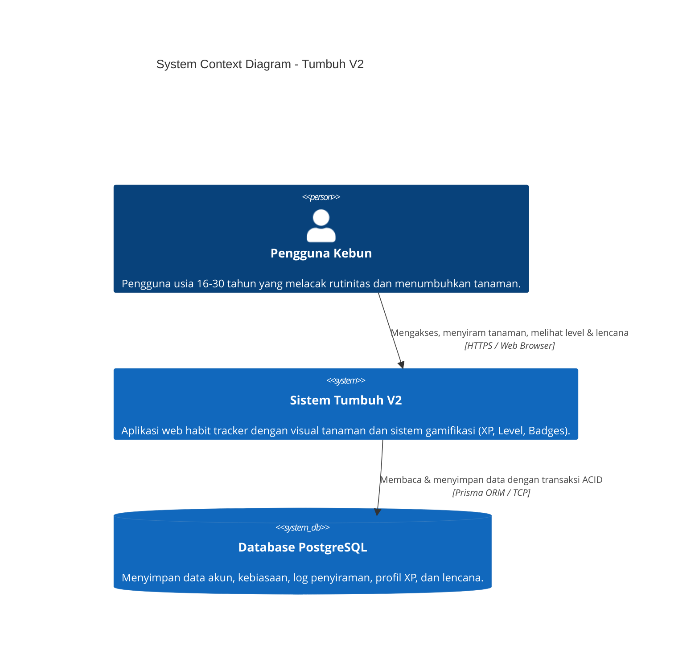
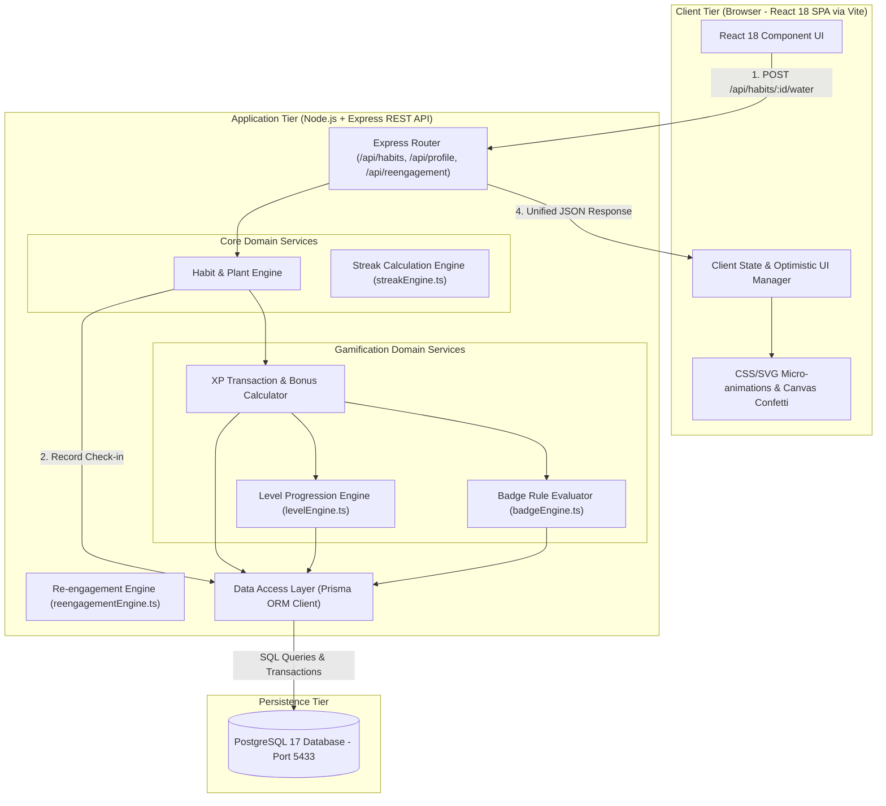
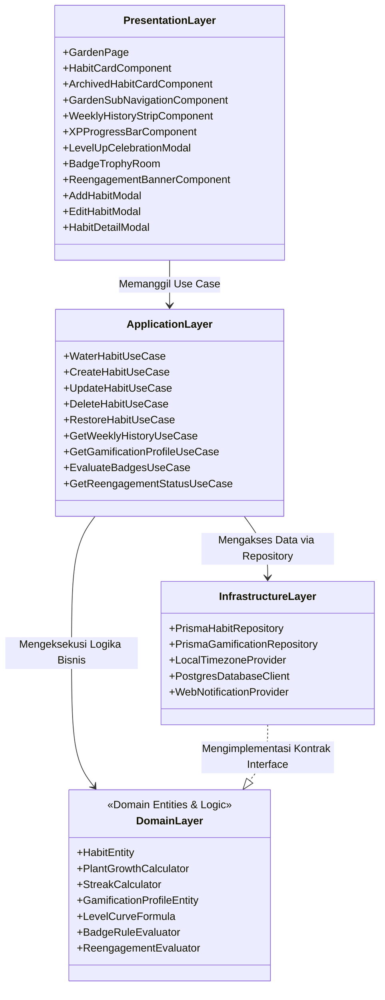
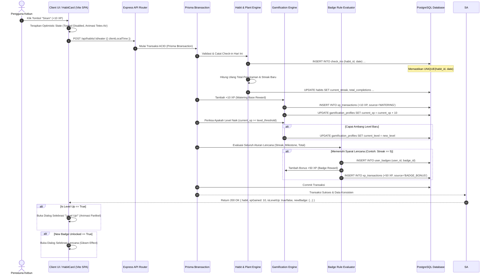
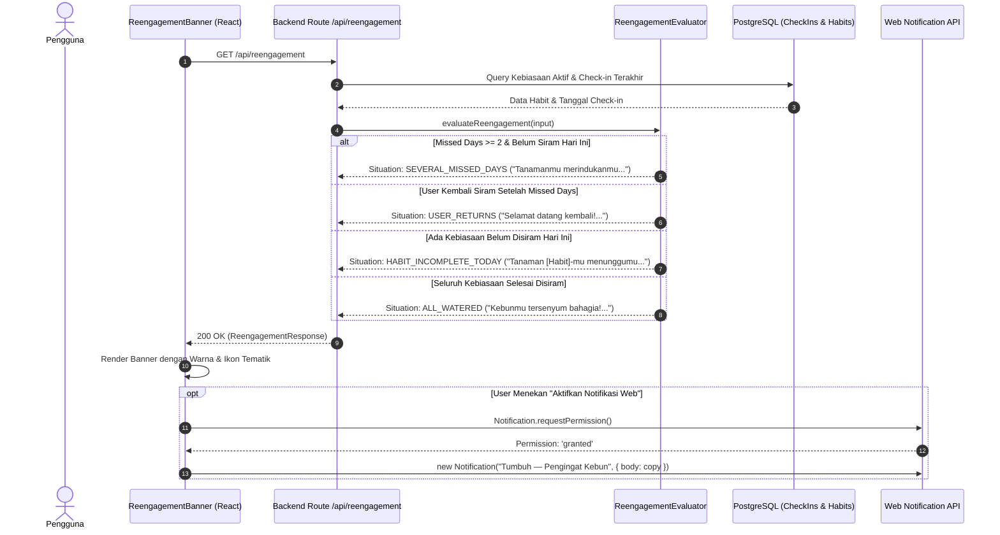
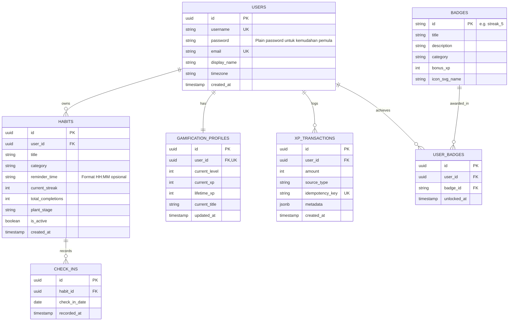

# Software Architecture Document (SAD) — Tumbuh V2
## *Gamified Habit Tracker with Plant Growth Metaphor*

---

### Metadata Dokumen
- **Nama Dokumen:** Software Architecture Document (SAD)
- **Nama Sistem:** Tumbuh Habit Tracker
- **Versi Sistem:** 2.0
- **Status:** Approved / Architecture Baseline
- **Penulis:** Lead System Architect
- **Dokumen Terkait:** [PRD Tumbuh V2](file:///data/apps/tumbuh/PRD/PRD_tumbuh_v2.md)

---

## 1. Pendahuluan

### 1.1 Tujuan Dokumen
Dokumen Arsitektur Perangkat Lunak (*Software Architecture Document* - SAD) ini menyajikan gambaran arsitektur komprehensif dari sistem **Tumbuh V2**. Dokumen ini menggunakan pendekatan multi-view (mengadopsi prinsip Kruchten 4+1 View Model dan C4 Model) untuk memetakan struktur logis, interaksi proses, arsitektur data, keputusan teknis, dan strategi implementasi sistem.

Dokumen ini ditujukan sebagai panduan resmi bagi tim pengembang (*engineers*), perekayasa kualitas (*QA*), dan tim produk dalam membangun sistem yang modular, aman, skalabel, serta mudah dirawat (*maintainable*).

### 1.2 Cakupan Sistem (System Scope)
Tumbuh V2 adalah aplikasi web responsif (*mobile-first*) yang menggabungkan pelacakan kebiasaan harian (*habit tracker*) dengan metafora visual pertumbuhan tanaman dan sistem gamifikasi terintegrasi (Experience Points, Leveling, dan Lencana Prestasi).

Batasan arsitektural:
- **Client Tier (`/data/apps/tumbuh/Code/frontend`):** Modern React 18 SPA berbasis Vite dengan animasi SVG/CSS murni yang memanfaatkan **100% GPU browser perangkat pengguna (0% beban GPU di server)**.
- **Application & API Tier (`/data/apps/tumbuh/Code/backend`):** Node.js + Express API Service berbasis TypeScript dengan Prisma ORM yang mengeksekusi logika bisnis secara *server-authoritative*.
- **Database Tier:** PostgreSQL 17 LTS/Stable pada port 5433 (`tumbuh_v2_db`) dengan transactional safety (ACID) untuk menjamin integritas data XP, streak, dan lencana.
- **Process Management & Resilience:** Dikelola secara persisten via Linux Systemd Daemon (`tumbuh-backend.service` dan `tumbuh-frontend.service`) dengan auto-restart mandiri (`Restart=always`).
- **Konsep Aksi:** *Check-in Harian* sebagai operasi bisnis inti di backend, dan *Menyiram Tanaman* sebagai metafora visual interaktif di antarmuka pengguna (UI).

---

## 2. Pendorong Arsitektur & Atribut Kualitas (Architectural Drivers)

### 2.1 Persyaratan Bisnis Utama
1. **Loop Hadiah Instan (*Instant Reward Loop*):** Aksi menyiram tanaman harus memberikan umpan balik visual dan matematis seketika (+10 XP dan status tanaman terupdate).
2. **Integritas Gamifikasi (*Gamification Integrity*):** Perolehan XP, kenaikan level, dan pembukaan lencana harus terverifikasi di server guna mencegah manipulasi sisi client.
3. **Ketahanan Streak & Non-Punitive UX:** Sistem harus mendukung pencatatan streak yang akurat tanpa merusak progres historis tanaman jika hari terlewat.

### 2.2 Atribut Kualitas (ISO/IEC 25010 Quality Attributes)

| Kategori Kualitas | Sasaran Spesifik | Strategi Arsitektural |
| :--- | :--- | :--- |
| **Performance Efficiency** | Waktu respons interaksi menyiram < 300 ms | - Optimistic UI di client.<br>- Transaksi database efisien dengan indeks terarah.<br>- Query gabungan (single transaction payload). |
| **Data Consistency & Reliability** | Tidak ada perolehan XP atau badge ganda untuk aksi yang sama | - PostgreSQL ACID Transactions.<br>- Database unique constraints `(habit_id, check_in_date)`.<br>- XP Ledger audit trail berbasis idempotency key. |
| **Modularity & Maintainability** | Logika gamifikasi terpisah bersih dari logika inti kebiasaan | - Pemisahan domain via Domain Event Pattern (`HabitWateredEvent`).<br>- Rule-based Strategy Pattern untuk Badge Evaluator. |
| **Usability & Responsiveness** | Pengalaman mobile mulus, ringan, dan ramah aksesibilitas | - Mobile-first component styling.<br>- Animasi berbasis GPU-friendly CSS transforms.<br>- Mendukung `prefers-reduced-motion`. |
| **Testability** | Cakupan unit test tinggi pada aturan kalkulasi | - Pure business logic functions (bebas dependensi I/O) untuk level progression & streak rules. |

---

## 3. Representasi Arsitektur Tingkat Tinggi (C4 Context & Container View)

### 3.1 C4 - System Context Diagram
Diagram ini menggambarkan batas sistem Tumbuh V2 dan interaksinya dengan aktor manusia serta sistem eksternal:



### 3.2 C4 - Container Diagram
Diagram ini membedah arsitektur internal di dalam runtime aplikasi Tumbuh V2:



---

## 4. Pandangan Logis (Logical View)

Arsitektur Tumbuh V2 mengadopsi prinsip **Clean Modular Architecture** yang memisahkan tanggung jawab ke dalam beberapa layer terdefinisi dengan jelas:



### 4.1 Dekomposisi Modul
1. **Module `Habits`:** Bertanggung jawab atas siklus hidup kebiasaan lengkap (Full CRUD: tambah, lihat, ubah, arsip/hapus), pengaturan waktu pengingat harian (`reminder_time`), dan agregasi riwayat 7 hari mingguan (*Weekly History*) berbasis tanggal kalender lokal pengguna.
2. **Module `Plants`:** Menghitung tahap pertumbuhan visual tanaman (Seed, Sprout, Growing, Bloom) murni berdasarkan total hari penyiraman kumulatif. Pada tahap **Bloom** (≥ 30 hari penyiraman), sistem menerapkan *progressive blooming engine*: menumbuhkan cabang-cabang baru, kanopi dedaunan lebat multi-layer, dan memekarkan bunga bertahap (1 bunga pada 30x siram hingga 5 bunga mekar penuh pada ≥ 38x siram) dengan status visual dan deskripsi dinamis.
3. **Module `Streaks & Recovery`:** Bertanggung jawab atas kalkulasi streak berbasis kalender lokal pengguna, mitigasi hari terlewat secara suportif tanpa merusak progres historis tanaman, dan antarmuka pemulihan langsung (*Supportive Recovery*).
4. **Module `Gamification`:**
   - **Sub-modul `XP`:** Mengelola ledger mutasi XP (+10 penyiraman, bonus streak, bonus mekar).
   - **Sub-modul `Levels`:** Menentukan ambang batas level, level-up threshold, dan pemberian gelar (*title*).
   - **Sub-modul `Badges`:** Mesin evaluasi aturan (*rule engine*) berbasis kondisi (misal: streak = 5 -> unlock `streak_5`).
5. **Module `Re-engagement & Notifications`:**
   - **Mesin Evaluasi Status (`ReengagementEvaluator`):** Menganalisis jeda ketidakhadiran dan status kelengkapan penyiraman hari ini.
   - **Penyedia Salinan Pesan Suportif:** Memastikan zero-guilt, warm tone, dan CTA kontekstual.
   - **Multi-channel Bridge:** Sinkronisasi In-App Banner dan Web Notification API browser.
6. **Module `Authentication & Multi-User Identity`:**
   - **Pendaftaran Sederhana (`POST /api/auth/signup`):** Mendaftarkan user baru dengan input Username dan Password, membuat profil gamifikasi awal (Level 1, 0 XP), serta menanam 3 kebiasaan awal (*starter habits*).
   - **Login Sederhana (`POST /api/auth/login`):** Memvalidasi kecocokan username dan password langsung dari database PostgreSQL tanpa token JWT atau session cookies rumit.
   - **Isolasi Identitas Berbasis Header (`x-user-id`):** Frontend menyertakan ID user aktif di setiap request header untuk mengisolasi kueri database (Tanaman, XP, Lencana) secara transparan.

---

## 5. Pandangan Proses & Interaksi (Process & Interaction View)

### 5.1 Alur Transaksi Penyiraman & Evaluasi Gamifikasi
Berikut adalah diagram urutan (*sequence diagram*) yang memperlihatkan bagaimana satu aksi penyiraman dieksekusi secara atomik dari client ke database:



### 5.2 Alur Evaluasi Re-engagement & Notifikasi Suportif
Berikut adalah diagram urutan alur cerdas penentuan pesan re-engagement yang hangat dan bebas rasa bersalah:



### 5.3 Alur Autentikasi Sederhana & Sessionless Multi-User Identity
Berikut adalah diagram urutan alur pendaftaran, login, dan pemisahan data per pengguna:

```mermaid
sequenceDiagram
    autonumber
    actor User as Pengguna / Calon Pekebun
    participant UI as LoginPage (Vite React)
    participant AuthAPI as Backend Route /api/auth
    participant DB as PostgreSQL 17 (users & relasi)
    participant App as Kebun Saya (App.tsx)

    %% Skenario A: Sign Up
    rect rgb(240, 253, 244)
    note right of User: Skenario A: Pendaftaran Akun Baru (Sign Up)
    User->>UI: Input User & Password -> Klik "Daftar & Mulai Menanam"
    UI->>AuthAPI: POST /api/auth/signup { username, password }
    AuthAPI->>DB: Cek keberadaan username unik
    alt Username sudah terdaftar
        AuthAPI-->>UI: 400 Bad Request ("Username sudah terdaftar")
    else Username tersedia
        AuthAPI->>DB: INSERT INTO users (username, password, display_name)
        AuthAPI->>DB: INSERT INTO gamification_profiles (user_id, level: 1, xp: 0)
        AuthAPI->>DB: INSERT INTO habits (3 tanaman starter: Minum Air, Baca Buku, Jalan Santai)
        AuthAPI-->>UI: 201 Created { success: true, user: { id, username, level: 1, currentXp: 0 } }
        UI->>UI: Simpan user di localStorage ('tumbuh_active_user')
        UI->>App: Render "Kebun Saya" langsung tanpa token/session
    end
    end

    %% Skenario B: Login
    rect rgb(254, 243, 199)
    note right of User: Skenario B: Masuk Akun Terdaftar (Login)
    User->>UI: Input User & Password -> Klik "Masuk ke Kebun Saya"
    UI->>AuthAPI: POST /api/auth/login { username, password }
    AuthAPI->>DB: SELECT * FROM users WHERE username = cleanUsername
    alt Password cocok dengan data database
        AuthAPI-->>UI: 200 OK { success: true, user: { id, username, displayName, level, currentXp } }
        UI->>UI: Simpan user di localStorage ('tumbuh_active_user')
        UI->>App: Masuk ke Kebun Saya (Render Garden View)
        App->>AuthAPI: Request data dengan header { 'x-user-id': user.id }
        AuthAPI->>DB: Query data hanya milik user.id (Kebun, XP, Lencana)
        DB-->>App: Data eksklusif milik pengguna tanpa tercampur
    else Password salah / user tidak ada
        AuthAPI-->>UI: 401 Unauthorized ("Username atau password salah")
    end
    end

    %% Skenario C: Logout
    rect rgb(254, 242, 242)
    note right of User: Skenario C: Keluar Akun (Logout)
    User->>App: Klik tombol "Logout" di Nav Bar Utama
    App->>App: localStorage.removeItem('tumbuh_active_user')
    App->>UI: Reset state dan kembali ke Halaman Login & Sign Up
    end
```



---

## 6. Pandangan Data & Persistensi (Data View)

Arsitektur data dirancang untuk menjaga integritas relasional, performa pencarian yang tinggi, serta riwayat audit yang lengkap (*immutable ledger* untuk XP).

### 6.1 Diagram Entitas Relasional (ERD)



### 6.2 Strategi Integritas & Anti-Eksploitasi Data
1. **Idempotency Key pada Transaksi XP:**
   Kolom `idempotency_key` pada `XP_TRANSACTIONS` diformat sebagai:
   $$\text{idempotency\_key} = \text{user\_id} + \text{":"} + \text{source\_type} + \text{":"} + \text{habit\_id} + \text{":"} + \text{date}$$
   Jika terjadi network retry atau klik ganda secara paralel, database akan menolak (*unique constraint violation*) dan mencegah akumulasi XP palsu.
2. **Atomic Integrity via Single Transaction:**
   Seluruh operasi (pencatatan check-in, update streak, penambahan XP, kalkulasi level, pemberian lencana) dibungkus dalam blok `prisma.$transaction`. Jika salah satu gagal, seluruh operasi di-*rollback*.

---

## 7. Pandangan Penggelaran & Fisik (Physical & Deployment View)

Sistem Tumbuh V2 dirancang untuk berjalan pada arsitektur modern full-stack web:

```mermaid
graph LR
    subgraph ClientDevice ["Perangkat Klien"]
        Browser["Mobile / Desktop Web Browser"]
    end

    subgraph CloudflareEdge ["Edge & Ingress Platform"]
        CFTunnel["Cloudflare Tunnel (towing-kediri)<br>Host: tumbuh.towingkediri.com"]
    end

    subgraph ServerHost ["Server Host (Linux Systemd Services)"]
        FrontendService["tumbuh-frontend.service<br>(Vite Preview - Port 5173)"]
        BackendService["tumbuh-backend.service<br>(Node.js + Express API - Port 8000)"]
    end

    subgraph DataPlatform ["Database Infrastructure"]
        PostgresInstance["PostgreSQL 17 Cluster Instance<br>(Port 5433 - DB: tumbuh_v2_db)"]
    end

    Browser -->|HTTPS Request| CFTunnel
    CFTunnel -->|Forward Traffic (Port 5173)| FrontendService
    FrontendService -->|Reverse Proxy /api/*| BackendService
    BackendService -->|Prisma Connection (TCP Port 5433)| PostgresInstance
```

---

## 8. Cross-Cutting Concerns

### 8.1 Manajemen Zona Waktu (Timezone Handling)
- Semua tanggal check-in disimpan dalam format tanggal kalender `YYYY-MM-DD` yang dihitung berdasarkan zona waktu pengguna (`Intl.DateTimeFormat` atau `date-fns-tz`).
- Ini mencegah *midnight UTC shift bug*, di mana pengguna yang menyiram pada pukul 06.00 WIB tercatat sebagai tanggal hari sebelumnya di server UTC.

### 8.2 Aksesibilitas & Reduksi Gerak (Motion Sensitivity)
- Seluruh animasi selebrasi (konfeti, rotasi badge) wajib mendeteksi media query CSS `@media (prefers-reduced-motion: reduce)`.
- Jika aktif, efek konfeti ditiadakan dan diganti dengan transisi *fade-in* sederhana berdurasi 150 ms.

### 8.3 Penanganan Error & Ketahanan UI
- Jika transaksi server gagal, state client akan melakukan *rollback* secara anggun (*graceful fallback*), menampilkan toast notifikasi ramah: *"Gagal mencatat penyiraman. Silakan coba sesaat lagi."*, tanpa membingungkan pengguna.

### 8.4 Arsitektur Notifikasi & Sapaan Re-engagement Suportif (Supportive Re-engagement Engine)
Sistem memisahkan evaluasi pesan pengingat ke dalam modul domain khusus (`ReengagementEvaluator`):
- **Evaluasi Berbasis Keadaan (State-Based Detection):**
  1. `HABIT_INCOMPLETE_TODAY`: Menganalisis relasi `check_ins` hari ini. Jika ada habit aktif yang belum disiram, sistem menyajikan pesan hangat: *"Tanaman [Nama]-mu menunggumu hari ini."*
  2. `SEVERAL_MISSED_DAYS`: Menganalisis selisih hari terakhir ($D_{\text{today}} - D_{\text{last}} \ge 2$). Menampilkan banner empati: *"Tanamanmu merindukanmu. Yuk bantu ia tumbuh kembali."*
  3. `USER_RETURNS`: Memicu umpan balik selebrasi ketika pengguna kembali menyiram setelah hari yang terlewat: *"Selamat datang kembali! Tanamanmu mulai tumbuh lagi."*
- **Kanal Pengiriman (Delivery Pipeline):**
  - **In-App Dynamic Banner:** Dirender pada level komponen React teratas di My Garden.
  - **Browser Web Notification API:** Terhubung dengan Service Worker / Web Notification browser pengguna dengan izin eksplisit (*opt-in permission*).

### 8.5 Mekanisme Pemulihan Suportif & Siklus Hidup Kebiasaan (Supportive Recovery & Habit Lifecycle)
- **Supportive Recovery Loop (`HabitDetailModal`):**
  Alih-alih mereset progres historis atau menghukum pengguna saat melewatkan hari, sistem menyediakan antarmuka pemulihan suportif. Pengguna disajikan pesan peneguhan empati non-hukuman (*zero-guilt*) serta tombol langsung *"Siram untuk Memulihkan (+10 XP)"* yang langsung memperbarui status tanpa friksi psikologis.
- **Riwayat Mingguan Kalender Lokal (7-Day History Strip):**
  Setiap kebiasaan menyajikan agregasi 7 hari terakhir kalender lokal pengguna (Senin s.d. Minggu). Status hari disiram (`isWatered: true`) dipetakan dari relasi `check_ins`, dengan indikator khusus cincin pada hari ini (`isToday: true`).
- **Pengelolaan Siklus Hidup Kebiasaan (Habit Lifecycle Management):**
  Sistem menyediakan mutasi penuh via `PUT /api/habits/:id` (pengubahan nama, kategori, jadwal jam pengingat) dan `DELETE /api/habits/:id` (pengarsipan aman `isActive: false` atau penghapusan permanen) dengan perlindungan konfirmasi modal dua langkah guna mencegah kehilangan data tak disengaja.

### 8.6 Arsitektur Penjadwal Pengingat Harian Real-Time (Scheduled Daily Reminder Ticker)
Sistem mengimplementasikan penjadwal waktu lokal di sisi client (`App.tsx`):
- **Evaluasi Frekuensi Tinggi (1 Detik Interval):** Menghitung selisih waktu (`diff`) antara jam lokal pengguna dengan `reminderTime` kebiasaan yang berstatus aktif dan **belum disiram hari ini (`!habit.isWateredToday`)**.
- **Jendela Toleransi Presisi (0 s.d. 5 Menit):** Memastikan jika pengguna membuka aplikasi tepat pada jamnya atau dalam jeda 5 menit berikutnya, pengingat tetap terpicu secara andal.
- **Tiga Aksi Umpan Balik Serentak:**
  1. *Web Audio API Synthesizer:* Membunyikan denting nada lembut dual-tone (D5 587.33Hz $\rightarrow$ A5 880Hz) tanpa beban unduhan file audio.
  2. *Web Browser Notification:* Mengirimkan notifikasi desktop native OS (`new Notification(...)`) dengan tag unik dan ikon `/favicon.ico`.
  3. *In-App Golden Daily Reminder Banner:* Menampilkan banner interaktif emas di bagian atas kebun dengan tombol aksi langsung *"💧 Siram Sekarang (+10 XP)"*.
- **Pencegahan Redundansi (Anti-Spam):** Menggunakan kunci penyimpanan `localStorage` berbasis `(habit_id, date, reminder_time)` yang dibersihkan secara otomatis saat preferensi jam diedit.

### 8.7 Arsitektur Paginasi Otomatis & Alur Pendaratan Kebiasaan Baru (Garden Pagination & Newest-First Slicing)
Untuk menjaga stabilitas performa DOM render ketika pengguna mengelola puluhan tanaman kebiasaan, sistem mengimplementasikan pagination sisi client secara terstruktur:
- **Batas Halaman Tetap (`HABITS_PER_PAGE = 6`):** Setiap tampilan grid (baik *Kebun Aktif* maupun *Arsip Kebun*) dibatasi maksimal 6 kartu per halaman.
- **Komponen Navigasi Adaptif ([GardenPagination.tsx](file:///data/apps/tumbuh/Code/frontend/src/components/GardenPagination.tsx)):** Menyediakan tombol navigasi mundur/maju (`◀` dan `▶`), nomor halaman interaktif, kompresi nomor elipsis (`…`) untuk daftar halaman panjang, serta counter informatif (*"Menampilkan X–Y dari Z tanaman"*). Komponen otomatis disembunyikan jika total item $\le 6$.
- **Pengurutan Newest-First:** Kebun Aktif diurutkan berdasarkan `new Date(b.createdAt).getTime() - new Date(a.createdAt).getTime()`.
- **Alur Auto-Landing Halaman 1:** Ketika pengguna menambahkan kebiasaan baru melalui `AddHabitModal`, mutasi state otomatis menyetel `gardenSubTab = 'active'` dan `activePage = 1`. Kebiasaan yang baru ditanam langsung tampil di slot pertama Halaman 1 dan menggeser tanaman sebelumnya, disertai pemanggilan `scrollToGardenTop()` yang mulus.

### 8.8 Pola Presentasi Status Puncak Gamifikasi (Max Level Presentation Pattern — Opsi A)
Untuk mengeliminasi anomali visual saat pengguna mencapai level tertinggi (Level 10 — *Dewa Flora*):
- **Deteksi Batas Akhir Level ([levelEngine.ts](file:///data/apps/tumbuh/Code/backend/src/services/levelEngine.ts)):** Fungsi `calculateLevelFromXp` menyertakan atribut `isMaxLevel: boolean` (bernilai `true` jika `level >= 10` atau XP $\ge 3.200$). Persentase progres dipatri penuh pada `100%`.
- **Formatting Header Tanpa Anomali Fraksi ([GamificationHeader.tsx](file:///data/apps/tumbuh/Code/frontend/src/components/GamificationHeader.tsx)):** Alih-alih menampilkan format perbandingan fraksi yang melebihi penyebutnya (seperti `6325 / 4080 XP`), UI otomatis mengubah format menjadi:
  $$\text{XP Progres: } \mathbf{X.XXX\text{ XP (MAX LEVEL)}}$$
  sehingga pengguna level puncak mendapatkan status prestisius tanpa kebingungan logika batas poin.

### 8.9 Arsitektur Autentikasi Sederhana & Isolasi Multi-User (Sessionless Header-Based Identity)
Untuk memenuhi kebutuhan sistem autentikasi yang ringan, mudah dipahami pemula (*beginner-friendly*), dan bebas dari kompleksitas JWT/cookie:
- **Penyimpanan Klien Sederhana (`localStorage`):** Objek user aktif `{ id, username, displayName, level, currentXp }` disimpan di `localStorage` klien dengan key `'tumbuh_active_user'`.
- **Injeksi Header `x-user-id`:** Seluruh panggilan API (`habits`, `profile`, `reengagement`, `badges`) dilewatkan melalui pembungkus `authFetch` yang secara otomatis menyertakan request header:
  $$\text{Request Header: } \mathbf{x\text{-}user\text{-}id: <id\_user\_aktif>}$$
- **Server Resolver & Isolasi Relasional ([habits.ts](file:///data/apps/tumbuh/Code/backend/src/routes/habits.ts)):** Fungsi pembantu `getRequestUser(req)` mengekstrak header `x-user-id` dan memastikan setiap operasi database (SELECT, INSERT, UPDATE, DELETE) selalu mengunci filter relasi:
  ```typescript
  where: { userId: user.id }
  ```
  sehingga tidak akan pernah terjadi kebocoran data (*zero data crossover*) antar pekebun yang berbeda.
- **Pemberian Starter Kit Tanaman:** Saat user mendaftar via `/api/auth/signup`, backend secara otomatis membuatkan 3 tanaman pembuka dan profil gamifikasi Level 1 (0 XP) agar kebun langsung siap dirawat.

### 8.10 Arsitektur Modul Administrator & Pengaturan Pertumbuhan Dinamis (Settings Engine)
Untuk memfasilitasi kebutuhan konfigurasi tahapan pertumbuhan dan durasi penyiraman demo:
- **Tabel `system_settings` ([schema.prisma](file:///data/apps/tumbuh/Code/backend/prisma/schema.prisma)):**
  Tabel berformat *Key-Value Configuration Entity* dengan struktur:
  ```prisma
  model SystemSetting {
    key         String   @id
    value       String   // Format JSON string konfigurasi GrowthSettings
    description String?
    updatedAt   DateTime @default(now()) @updatedAt @map("updated_at")

    @@map("system_settings")
  }
  ```
- **Engine Pengaturan ([settingsEngine.ts](file:///data/apps/tumbuh/Code/backend/src/services/settingsEngine.ts)):**
  Menyediakan fungsi terisolasi dan mudah dibaca:
  1. `getSystemGrowthSettings()`: Membaca pengaturan aktif dari database dengan fallback aman ke `DEFAULT_GROWTH_SETTINGS`.
  2. `saveSystemGrowthSettings(payload)`: Menyimpan pembaruan konfigurasi yang diinput administrator.
  3. `resetSystemGrowthSettings()`: Mengembalikan nilai ke standar bawaan pabrik (30x, 31x, 32x, 34x, 36x, 38x siram).
  4. `calculatePlantStageDynamic(totalCompletions, settings)`: Menghitung tahap tanaman ('SEED' | 'SPROUT' | 'GROWING' | 'BLOOM') secara dinamis sesuai konfigurasi aktif.
- **Proteksi Hak Akses Administrator ([admin.ts](file:///data/apps/tumbuh/Code/backend/src/routes/admin.ts)):**
  Middleware `requireAdmin` memverifikasi apakah pemanggil memiliki `user.role === 'ADMIN'` atau `username === 'admin'`. Jika bukan admin, server langsung merespons dengan HTTP **403 Forbidden**.
- **Mode Interval Demo dalam Menit:**
  Pada mode `MINUTES`, penyiraman berikutnya dapat dilakukan setelah durasi menit yang ditentukan (misal: 1 menit, 2 menit). Server memeriksa selisih waktu `(now - lastCheckIn.recordedAt)`. Jika belum mencapai batas menit, server menolak duplikasi dengan status cooldown. Jika sudah melewati batas menit, penyiraman diizinkan dan tanaman bertumbuh tanpa harus menunggu 24 jam kalender.

### 8.11 Arsitektur Berbagi Sosial & Generator Poster Pencapaian (Social Media Sharing Engine)
- **Tujuan Arsitektural:** Memfasilitasi pengguna untuk membagikan capaian positif (saat meraih lencana baru dan saat menyelesaikan Mahkota Megah 5/5) ke Facebook dan WhatsApp tanpa membebani backend server dengan rendering gambar statis.
- **Client-Side HTML5 Canvas Poster Renderer ([socialShare.ts](file:///data/apps/tumbuh/Code/frontend/src/utils/socialShare.ts)):**
  - Mengonversi data pencapaian menjadi file gambar poster PNG beresolusi portrait 1080×1350 px secara murni di memori browser pengguna (`canvas.toDataURL('image/png')`).
  - Merender visual pohon bermahkota 5 bunga emas atau medali emas lencana, kartu bernuansa botani (*warm botanical palette*), statistik penyiraman, nama pekebun, dan kutipan motivasi *terus Tumbuh*.
  - Menghasilkan 0% beban komputasi CPU/GPU di server backend.
- **Protokol Integrasi Facebook & WhatsApp:**
  - **Facebook Web Sharer:** Menggunakan format URL standar `https://www.facebook.com/sharer/sharer.php?u={url}&quote={quote}` yang aman dari pemblokiran popup dan langsung memuat pesan apresiasi serta tautan publik kebun.
  - **WhatsApp Native Deep-Linking:**
    - Pada perangkat mobile (iOS / Android), sistem memanggil protocol handler `whatsapp://send?text=...` sehingga langsung beralih ke aplikasi WhatsApp native. Di aplikasi, kontak teratas yang ditawarkan WhatsApp adalah opsi **"Status Saya (My Status)"** sehingga pengguna dapat menjadikannya status WhatsApp dengan satu ketukan.
    - Pada perangkat desktop browser, sistem memanggil `https://api.whatsapp.com/send?text=...` untuk membuka WhatsApp Web/Desktop.
  - **Salinan Pesan Otomatis (Clipboard Fallback):** Sistem menyalin teks ucapan motivasi ke clipboard (`navigator.clipboard` dengan fallback ke `document.execCommand('copy')` agar kompatibel pada koneksi HTTP LAN maupun HTTPS) dan otomatis mengunduh file poster PNG ke folder unduhan pengguna.

---

## 9. Catatan Keputusan Arsitektur (Architectural Decision Records / ADR)

### ADR-01: Arsitektur Decoupled (Vite React 18 Frontend + Express Prisma Backend)
- **Konteks:** Kebutuhan antarmuka grafis yang super ringan dan berkecepatan tinggi dengan 100% animasi berjalan di GPU klien, serta backend REST API yang server-authoritative, stabil, dan independen.
- **Keputusan:** Menggunakan React 18 SPA berbasis Vite di frontend (`Code/frontend`, port 5173) dan Node.js Express REST API dengan Prisma ORM & PostgreSQL 17 di backend (`Code/backend`, port 8000), dikelola secara persisten dengan Linux Systemd Daemon (`tumbuh-frontend.service` dan `tumbuh-backend.service`).
- **Konsekuensi:** Pemisahan *concerns* yang sangat bersih, *build* frontend instan (<1 detik via Vite), independensi restart backend tanpa mematikan UI, self-healing otomatis via systemd jika service crash, serta performa CPU/GPU server yang sangat hemat.

### ADR-02: Server-Authoritative Gamification Logic
- **Konteks:** Menentukan apakah kalkulasi XP dan evaluasi lencana dilakukan di browser atau di server.
- **Keputusan:** Seluruh kalkulasi matematis XP, level, dan syarat badge dilakukan secara mutlak di sisi server.
- **Konsekuensi:** Mencegah eksploitasi manipulasi state dari DevTools, menjamin konsistensi data lintas perangkat.

### ADR-03: Rule-Based Evaluator Pattern untuk Lencana
- **Konteks:** Sistem lencana membutuhkan penambahan kriteria baru di masa depan secara modular tanpa merusak kode check-in utama.
- **Keputusan:** Mengimplementasikan pola Strategy/Rule Evaluator terpisah. Modul penyiraman hanya memancarkan event, lalu mesin pengevaluasi lencana menguji daftar predikat secara independen.
- **Konsekuensi:** *Extensible* (menambah lencana baru hanya perlu menambah fungsi predikat kondisi baru).

### ADR-04: Autentikasi Sederhana Tanpa Token / Session Cookies
- **Konteks:** Kebutuhan sistem autentikasi dan registrasi yang sederhana, transparan, dan mudah dimengerti serta dimaintain oleh programmer pemula tanpa kerumitan JWT token expiration, secret rotation, atau cookies CORS.
- **Keputusan:** Menggunakan validasi langsung Username & Password dari database PostgreSQL via `POST /api/auth/login` dan `POST /api/auth/signup`, menyimpan identitas pengguna aktif di `localStorage`, dan meneruskan `x-user-id` pada request header untuk mengisolasi kebun masing-masing.
- **Konsekuensi:** Kode sangat bersih, mudah dipelajari (*beginner-friendly*), cepat dieksekusi, dan isolasi relasional tanaman, XP, serta lencana antar-user tetap terjamin 100% di level database.

### ADR-05: Dynamic Plant Growth Stages & Minute Demo Interval Engine via Key-Value Entity
- **Konteks:** Penguji/evaluator membutuhkan kemampuan menguji tahapan morfologi mekar bunga (1-5 bunga) dan cabang secara cepat tanpa harus menunggu berhari-hari, serta administrator memerlukan kemampuan fleksibel untuk mengatur ambang batas penyiraman (X kali siram).
- **Keputusan:** Menyimpan konfigurasi ambang batas pertumbuhan dan mode jeda penyiraman di tabel `system_settings` (`growth_settings`), menyediakan halaman antarmuka `AdminSettingsPage` khusus bagi pengguna `admin`, dan mengevaluasi status tanaman secara dinamis baik di backend (`calculatePlantStageDynamic`) maupun di frontend visual (`PlantIllustration`).
- **Konsekuensi:** Sistem sangat adaptif untuk kebutuhan demo langsung, kode tetap sederhana dan mudah dipahami programmer pemula, dan data bawaan tetap dapat dipulihkan kapan saja dengan tombol 1-klik (*Reset to Factory Default*).

### ADR-06: Zero-Server-Cost Client-Side Canvas Rendering untuk Berbagi Sosial
- **Konteks:** Kebutuhan pengguna membagikan pencapaian lencana dan mahkota megah ke Facebook dan WhatsApp beserta poster bergambar dan caption motivasi tanpa membebani server backend dengan library rendering gambar berat seperti Puppeteer/Canvas server-side.
- **Keputusan:** Mengimplementasikan rendering poster PNG 1080×1350 sepenuhnya di client browser menggunakan HTML5 Canvas API murni, menggunakan protokol URL scheme `whatsapp://send` dan `facebook.com/sharer`, serta otomatis mengunduh file poster secara lokal.
- **Konsekuensi:** 0% beban CPU/GPU server, rendering poster instan (<50 ms di perangkat pengguna), privasi pengguna terlindungi tanpa penyimpanan file sementara di disk server, dan kompatibel baik di layar HP maupun desktop.

---
*Dokumen ini menjadi landasan arsitektural resmi untuk implementasi detail pada [Architecture Specification Arc_tumbuh_v2.md](file:///data/apps/tumbuh/Architecture/Arc_tumbuh_v2.md).*
